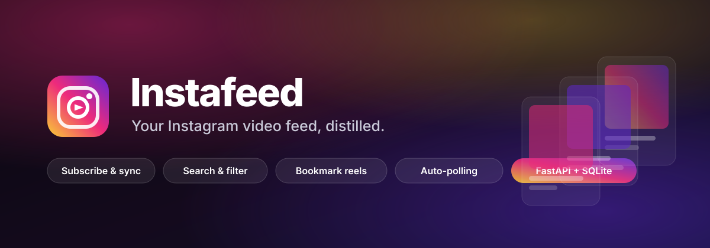

<p align="center">
  
</p>

<p align="center">
  <a href="#-quick-start"></a>
  <a href="#-api-reference"></a>
  <a href="#-testing--quality"></a>
  
  
</p>

<p align="center">
  <b>Instafeed</b> turns the Instagram handles you care about into
  <b>one searchable, bookmarkable, always-fresh video feed</b> — pulled automatically
  in the background, delivered the moment it lands.
</p>

<p align="center">
  <a href="#-quick-start"><b>🚀 Run it in 30 seconds</b></a>
  &nbsp;·&nbsp;
  <a href="#-architecture"><b>🏗 Architecture</b></a>
  &nbsp;·&nbsp;
  <a href="#-api-reference"><b>📡 API</b></a>
  &nbsp;·&nbsp;
  <a href="#-deployment"><b>☁️ Deploy</b></a>
  &nbsp;·&nbsp;
  <a href="#-roadmap"><b>🗺 Roadmap</b></a>
</p>

---

## 📖 Table of Contents

- [The Problem](#-the-problem)
- [What Instafeed Does](#-what-instafeed-does)
- [Highlights](#-highlights)
- [Quick Start](#-quick-start)
- [Demo Mode](#-demo-mode)
- [Architecture](#-architecture)
- [Tech Stack](#-tech-stack)
- [Project Structure](#-project-structure)
- [API Reference](#-api-reference)
- [Configuration](#-configuration)
- [Deployment](#-deployment)
- [Security](#-security)
- [Testing & Quality](#-testing--quality)
- [Roadmap](#-roadmap)
- [Contributing](#-contributing)
- [FAQ](#-faq)
- [License](#-license)

---

## 🎯 The Problem

Following a creator on Instagram means *scrolling past everything else*.
The algorithm decides what you see, the feed refreshes itself, and the reel
you wanted yesterday is buried under a thousand others — gone forever.

Creators feel the mirror image of this: a post that worked is invisible to
the 90% of followers who never scrolled back to it.

**Instafeed is the fix.** You subscribe to *handles*, not to an algorithm.
A background worker polls each one, de-duplicates everything it finds, and
builds a private, permanent, searchable library of reels — with the
engagement numbers that tell you which ones actually landed.

> **One sentence:** *Subscribe to creators, not to algorithms.*

---

## ✨ What Instafeed Does

```
   Search a handle  →  Subscribe  →  Background poller pulls every reel
                                                    │
                     ┌──────────────────────────────┘
                     ▼
        A private feed: sorted, filtered, searchable,
        bookmarkable, exportable — and yours forever.
```

| | |
|---|---|
| 🔍 **Discover** | Multi-strategy handle search (anonymous web API → logged-in session → exact-handle fallback) so a single blocked endpoint never breaks the product. |
| 🔔 **Subscribe** | Track any public creator. Poll the latest 10 posts every cycle — fast, polite and rate-limit friendly. |
| 🗂 **Collect** | Every reel is cached locally with likes, comments, views, duration and permalink. De-duplicated by shortcode, so nothing is ever stored twice. |
| 🎛 **Curate** | Sort by newest / most liked / most viewed / most reactions. Filter by creator, free-text search, or bookmarks-only. |
| 🔖 **Bookmark** | Save reels to a personal collection with optional notes. |
| 📊 **Understand** | Insights dashboard: top creators, publishing activity, engagement totals, full sync history. |
| 📤 **Take it with you** | Export the whole feed as JSON, CSV or Markdown. A `/api/digest` endpoint gives bots and automations a compact feed summary. |
| 🧑 **Your account** | Real multi-user auth with PBKDF2-hashed passwords and signed stateless sessions. Every user's data is fully isolated. |

---

## 🌟 Highlights

<table>
<tr>
<td width="50%" valign="top">

**🛡️ Production-grade authentication — zero extra dependencies**

- PBKDF2-HMAC-SHA256 password hashing (240,000 iterations, per-user salt)
- Stateless HMAC-SHA256 session tokens with a 30-day expiry
- Constant-time verification; tokens never appear in URLs
- Every single query is scoped to the authenticated `user_id`

</td>
<td width="50%" valign="top">

**🤝 Instagram-safe by design**

- Global throttle enforces a minimum delay between upstream calls
- Automatic fallbacks across three independent search strategies
- Actionable error messages (`HTTP 429` → *"set INSTAGRAM_LOGIN"*)

</td>
</tr>
<tr>
<td width="50%" valign="top">

**📦 Zero-build frontend**

- Vanilla ES2020 + a token-driven design system
- No bundler, no `node_modules`, no framework drift
- Dark & light themes, responsive down to 320px
- Skeleton loaders, toasts, keyboard shortcuts (`/` to search)

</td>
<td width="50%" valign="top">

**🧪 Ships with a real test-suite**

- 39 tests covering auth, storage and every API group
- Runs against a deterministic offline provider — **never** touches Instagram
- Ruff lint + format enforced in CI across Python 3.10 / 3.11 / 3.12
- Docker image build + container smoke-test in CI

</td>
</tr>
</table>

---

## 🚀 Quick Start

### Option 1 — Docker (recommended)

```bash
git clone https://github.com/Kumar44developer/instafed.git
cd instafed
docker compose up -d --build
```

Open **<http://localhost:8000>** → create an account → you're live.

### Option 2 — Local Python

```bash
git clone https://github.com/Kumar44developer/instafed.git
cd instafed

python -m venv .venv
source .venv/bin/activate          # Windows: .venv\Scripts\activate

pip install -r requirements.txt
uvicorn backend.main:app --reload --port 8000
```

Open **<http://localhost:8000>**.

> **New to the project?** Jump to [Demo Mode](#-demo-mode) — it runs completely
> offline with realistic sample data, so you can explore every feature
> without an Instagram account.

### Option 3 — Make it short

```bash
make install     # create .venv + install dependencies
make run         # start the dev server with hot reload
make test        # run the test-suite
```

---

## 🧪 Demo Mode

Instafeed ships with a deterministic **offline provider** so you can develop,
demo and test the entire product without touching Instagram.

```bash
# macOS / Linux
INSTAFEED_DEMO=1 uvicorn backend.main:app --reload

# Windows (PowerShell)
$env:INSTAFEED_DEMO="1"; uvicorn backend.main:app --reload
```

Or via Docker:

```bash
INSTAFEED_DEMO=1 docker compose up -d --build
```

Want a pre-populated account with content already waiting?

```bash
python scripts/seed_demo.py          # creates demo / demo1234
```

Demo mode swaps the live provider for `DemoProvider` behind the exact same
interface — the rest of the application cannot tell the difference.

---

## 🏗 Architecture

```
                        ┌──────────────────────────────┐
   Browser  ──────────▶ │        FastAPI application     │
   (vanilla SPA)        │  backend/main.py  ·  24 routes │
                        └───────────────┬──────────────────┘
                                        │
              ┌─────────────────────────┼─────────────────────────┐
              ▼                         ▼                         ▼
      ┌───────────────┐        ┌────────────────┐        ┌────────────────┐
      │  auth.py      │        │  database.py   │        │  instagram.py  │
      │ PBKDF2 hash   │        │  SQLite (WAL)  │        │  Live / Demo   │
      │ HMAC tokens   │        │  5 tables      │        │  providers     │
      └───────────────┘        └───────┬────────┘        └───────┬────────┘
                                        │                         │
                                        │                   ┌─────▼─────────┐
                                        │                   │  throttle +   │
                                        │                   │  fallbacks +  │
                                        │                   │  429 handling │
                                        │                   └─────┬─────────┘
                                        │                         │
                                        │                   ┌─────▼─────────┐
                                        ▼                   │   Instagram   │
                                 ┌──────────────┐            └───────────────┘
                                 │  scheduler.py│
                                 │  daemon poll │
                                 │  every 15 m  │
                                 └──────────────┘
```

**Request flow — one poll cycle**

```
scheduler thread
      │
      ├─▶ for every user
      │      └─▶ for every subscription
      │             ├─▶ ig.get_videos(username, limit=10)   ← throttled call
      │             ├─▶ db.insert_new_videos(...)   ← dedupe by shortcode
      │             └─▶ db.record_poll(...)          ← audit trail
      │
      └─▶ dashboard reads SQLite — newest first, no Instagram traffic
```

**Why this shape?**

| Decision | Reason |
|---|---|
| SQLite in WAL mode | Zero-ops persistence with concurrent reads while a poll writes. Swap for Postgres by changing `database.py` alone. |
| Cache-first feed reads | The dashboard never blocks on Instagram. A cold feed renders instantly from the cache. |
| Dedupe by shortcode | Instagram reuses post ids; the primary key `(user_id, id)` makes double-inserts impossible. |
| Provider interface | `LiveProvider` and `DemoProvider` are interchangeable — that is what makes the test-suite hermetic. |
| In-process scheduler | Works anywhere uvicorn runs. Set `INSTAFEED_SCHEDULER=0` and trigger `POST /api/poll` from any external cron instead. |

---

## 🧰 Tech Stack

| Layer | Choice | Why |
|---|---|---|
| **API** | FastAPI 0.150 | Async-ready, typed, first-class OpenAPI docs at `/api/docs` |
| **Validation** | Pydantic v2 | Declarative request models with field validators |
| **Server** | Uvicorn | ASGI standard, `--proxy-headers` for reverse proxies |
| **Storage** | SQLite 3 (WAL) | Single-file, zero-config, transactional, fast enough for 10⁵ rows |
| **Instagram** | instaloader + public web API | Mature, actively maintained, handles pagination for us |
| **Auth** | `hashlib` + `hmac` (stdlib) | No extra dependency, no supply-chain risk |
| **Frontend** | Vanilla ES2020 + CSS | No build step, no framework churn, ~30 KB total |
| **Testing** | pytest + FastAPI TestClient | Hermetic tests against the offline provider |
| **Tooling** | Ruff | Lint + format, 10× faster than the legacy stack |
| **Deploy** | Docker (multi-stage) | ~150 MB runtime image, non-root user, health-checked |

---

## 📁 Project Structure

```
instafed/
├── backend/
│   ├── __init__.py
│   ├── main.py            # FastAPI app — 24 routes, lifespan, SPA hosting
│   ├── config.py          # Every tunable, read from the environment once
│   ├── auth.py            # PBKDF2 hashing + HMAC signed session tokens
│   ├── deps.py            # `current_user` / `optional_user` dependencies
│   ├── database.py        # SQLite storage — users, subscriptions, videos,
│   │                      #   bookmarks, poll_log + aggregate statistics
│   ├── instagram.py       # LiveProvider & DemoProvider behind one interface
│   └── scheduler.py       # Background polling daemon + run_poll()
├── frontend/
│   ├── index.html         # Semantic SPA shell
│   ├── style.css          # Token-driven design system (dark + light)
│   └── app.js             # Router, API client, views, optimistic UI
├── scripts/
│   ├── poll_once.py       # One-shot poll — wire it into any cron
│   └── seed_demo.py       # Populate a demo account with sample content
├── tests/
│   ├── conftest.py        # Fixtures: temp DB, TestClient, account factory
│   ├── test_auth.py       # Registration, login, tokens, isolation
│   ├── test_database.py   # Storage layer, filters, cascade deletes
│   └── test_api.py        # Every API group, end to end
├── assets/
│   ├── banner.svg         # README hero
│   └── logo.svg
├── .github/workflows/     # CI: lint · test (3.x) · docker build + smoke test
├── Dockerfile             # Multi-stage, non-root, health-checked
├── docker-compose.yml
├── Makefile
├── pyproject.toml         # Packaging, pytest & ruff configuration
├── requirements.txt
├── requirements-dev.txt
├── .env.example
├── CONTRIBUTING.md
├── SECURITY.md
└── LICENSE
```

---

## 📡 API Reference

Interactive docs live at **`/api/docs`** (Swagger UI) and **`/api/redoc`**.

> Every route below the auth line requires `Authorization: Bearer <token>`.

### Authentication

| Method | Endpoint | Description |
|---|---|---|
| `POST` | `/api/auth/register` | Create an account → `{ token, user }` |
| `POST` | `/api/auth/login` | Sign in → `{ token, user }` |
| `GET` | `/api/auth/me` | Current profile |
| `DELETE` | `/api/auth/me` | Delete the account and all its data |

### Discovery & subscriptions

| Method | Endpoint | Description |
|---|---|---|
| `GET` | `/api/search?q=` | Find handles by name |
| `POST` | `/api/subscribe` | Subscribe to a handle |
| `GET` | `/api/subscriptions` | List your subscriptions |
| `DELETE` | `/api/subscriptions/{username}` | Unsubscribe (+ drop cached videos) |
| `GET` | `/api/subscriptions/{username}/videos` | **Every** video of one handle (`?refresh=true`, `?limit=N`) |

### Feed

| Method | Endpoint | Description |
|---|---|---|
| `GET` | `/api/feed` | The main feed — `?page=`, `?page_size=`, `?sort=`, `?username=`, `?q=`, `?bookmarked=`, `?refresh=` |
| `GET` | `/api/feed/export` | Export as `?format=json\|csv\|markdown` |
| `GET` | `/api/digest` | Compact summary for bots & automations |
| `DELETE` | `/api/videos/{video_id}` | Drop one video from the cache |

### Bookmarks, insights & operations

| Method | Endpoint | Description |
|---|---|---|
| `GET` `POST` | `/api/bookmarks` | List / save a video |
| `DELETE` | `/api/bookmarks/{video_id}` | Remove a saved video |
| `GET` | `/api/stats` | Dashboard aggregates, top creators, timeline, sync history |
| `POST` | `/api/poll` | Run a poll cycle right now |
| `GET` | `/api/poll/status` | When did the last poll run? |
| `GET` | `/api/health` | Liveness probe (no auth) |
| `GET` | `/api/config` | Public runtime configuration |

### Example

```bash
TOKEN=$(curl -s -X POST http://localhost:8000/api/auth/login \
  -H "Content-Type: application/json" \
  -d '{"username":"demo","password":"demo1234"}' | jq -r .token)

curl -s http://localhost:8000/api/feed?sort=popular\&page_size=5 \
  -H "Authorization: Bearer $TOKEN" | jq '.videos[] | {username, likes, views}'
```

---

## ⚙️ Configuration

Every setting is an environment variable. Copy `.env.example` to `.env` and
adjust — nothing else is required.

| Variable | Default | Purpose |
|---|---|---|
| `INSTAFEED_SECRET_KEY` | auto-generated | HMAC key for session tokens. **Set this in production.** |
| `INSTAFEED_DB_PATH` | `./instafeed.db` | SQLite database location |
| `INSTAFEED_CORS_ORIGINS` | `http://localhost:8000` | Comma-separated allowed origins |
| `INSTAFEED_SCHEDULER` | `1` | `0` disables the in-process polling thread |
| `INSTAFEED_DEMO` | `0` | `1` serves deterministic offline sample data |
| `INSTAFEED_TOKEN_TTL_DAYS` | `30` | Session token lifetime |
| `INSTAFEED_MIN_PASSWORD_LENGTH` | `8` | Minimum password length |
| `INSTAFEED_PAGE_SIZE` | `24` | Default feed page size |
| `INSTAGRAM_LOGIN` | — | Instagram username (recommended — avoids HTTP 429) |
| `INSTAGRAM_PASSWORD` | — | Instagram password |
| `INSTAGRAM_REQUEST_DELAY` | `1.5` | Minimum seconds between upstream calls |
| `POLL_INTERVAL_MINUTES` | `15` | Scheduler interval |
| `POLL_LATEST_LIMIT` | `10` | Videos checked per subscription per cycle |

---

## ☁️ Deployment

### Docker (any platform)

```bash
docker build -t instafeed:latest .
docker run -d -p 8000:8000 \
  -e INSTAFEED_SECRET_KEY="$(openssl rand -base64 48)" \
  -v instafeed-data:/data \
  instafeed:latest
```

The image is multi-stage, runs as a **non-root user**, declares a
`HEALTHCHECK` and stores its database in the `/data` volume.

### Render / Railway / Fly.io / Coolify

1. Deploy from this repository (Dockerfile is auto-detected).
2. Set `INSTAFEED_SECRET_KEY` and, if you want live data,
   `INSTAGRAM_LOGIN` + `INSTAGRAM_PASSWORD`.
3. Mount a persistent disk and point `INSTAFEED_DB_PATH` at it.
4. Health check path: `/api/health`.

### Serverless (Vercel / AWS Lambda)

SQLite needs a persistent filesystem, so run the scheduler externally:

```bash
INSTAFEED_SCHEDULER=0   # disable the in-process thread
```

and hit `POST /api/poll` from Vercel Cron, GitHub Actions or any cron:

```yaml
# .github/workflows/sync.yml
name: Instafeed sync
on:
  schedule: [{ cron: "*/15 * * * *" }]
  workflow_dispatch:

jobs:
  sync:
    runs-on: ubuntu-latest
    steps:
      - run: python scripts/poll_once.py
```

---

## 🔐 Security

Full details in [`SECURITY.md`](SECURITY.md). The highlights:

| Concern | Measure |
|---|---|
| Password storage | PBKDF2-HMAC-SHA256 · 240,000 iterations · per-user random salt |
| Sessions | Stateless HMAC-SHA256 tokens · 30-day expiry · `Authorization` header only |
| SQL injection | Parameterised queries throughout — no string-built SQL |
| XSS | Every user-supplied value is HTML-escaped before rendering |
| Data isolation | Every read/write is scoped to the authenticated `user_id` |
| Upstream abuse | Request throttling, exponential back-off, polite polling |
| Secrets in git | `.env`, `*.secret`, `instafeed.db*` are git-ignored |

**Production checklist**

- [ ] Set a long, random `INSTAFEED_SECRET_KEY`
- [ ] Restrict `INSTAFEED_CORS_ORIGINS` to your real origin
- [ ] Terminate TLS in front of the app
- [ ] Back up the SQLite file regularly
- [ ] Use a dedicated unprivileged user on the host

---

## 🧪 Testing & Quality

```bash
make test        # 39 tests
make lint        # ruff check
make coverage    # coverage report → htmlcov/index.html
```

The suite is **hermetic**: `INSTAFEED_DEMO=1` and a throwaway SQLite file
mean tests never touch Instagram and never touch your data.

CI runs on every push and pull request:

- ✅ Ruff lint **and** format check
- ✅ Pytest with coverage on **Python 3.10, 3.11 and 3.12**
- ✅ Docker image build **and** container smoke test

```
backend/database.py    96%   ███████████████████░
backend/auth.py        86%   █████████████████░░░
backend/main.py        85%   █████████████████░░░
backend/deps.py        74%   ██████████████░░░░░░
backend/scheduler.py   68%   █████████████░░░░░░░
backend/config.py      59%   ███████████░░░░░░░░░░
backend/instagram.py   36%   ███████░░░░░░░░░░░░░░   (live network paths — intentionally untested)
────────────────────────────────────────────────────
TOTAL                  71%   ██████████████░░░░░░░
```

`backend/instagram.py` is lower on purpose: the live provider talks to
Instagram, so the suite exercises it through the offline `DemoProvider`
instead. The live network paths are covered by manual QA and the Docker
smoke-test, not by CI.

---

## 🗺 Roadmap

- [x] Multi-strategy handle search with automatic fallbacks
- [x] Multi-user accounts with hashed passwords and signed sessions
- [x] Background poller with de-duplication and an audit trail
- [x] Searchable, sortable, paginated feed
- [x] Bookmarks with notes
- [x] Insights dashboard
- [x] JSON / CSV / Markdown export
- [x] Docker, CI, tests, docs
- [ ] **Reel audio + transcript extraction** — search inside spoken content
- [ ] **Watch-history & resume playback** across sessions
- [ ] **Smart collections** — auto-file reels by hashtag, creator or topic
- [ ] **Email & Telegram digests** — push new reels to you where you already are
- [ ] **Postgres adapter** — swap `database.py` for multi-node deployments
- [ ] **PWA + offline mode** — install to the home screen, keep watching offline
- [ ] **Public API keys** — programmatic access for your own tooling

---

## 🤝 Contributing

Contributions are welcome — issues, ideas, bug reports and pull requests.

1. Fork the repository and create a branch.
2. `make dev` to set up, `make test` before you push.
3. Keep the dependency list short — the standard library first.
4. Every behaviour change ships with a test.
5. Never log credentials.

Read the full guide in [`CONTRIBUTING.md`](CONTRIBUTING.md).

---

## ❓ FAQ

**Does this need an Instagram account?**
No. Demo mode runs fully offline. For live data, anonymous access works but
rate-limits quickly — supplying `INSTAGRAM_LOGIN` / `INSTAGRAM_PASSWORD`
gives you a logged-in session and removes most HTTP 429s.

**Is this legal / allowed?**
Instafeed is a personal, self-hosted tool. Respect Instagram's Terms of
Service and content creators' rights. It only reads **public** profiles and
never downloads private content.

**Why SQLite? Can I use Postgres?**
SQLite in WAL mode handles this workload comfortably and removes an entire
class of deployment pain. The storage layer is isolated in `database.py` —
swap it out when you need to.

**How do I avoid rate limits?**
Set the Instagram credentials, keep `INSTAGRAM_REQUEST_DELAY` at or above
`1.5`, and don't set `POLL_INTERVAL_MINUTES` below 10.

**Can I run this without the built-in scheduler?**
Yes — set `INSTAFEED_SCHEDULER=0` and trigger `POST /api/poll` (or
`scripts/poll_once.py`) from an external cron.

**Does it support private accounts?**
No, and deliberately so. Private profiles require a logged-in follow
relationship and raise an explicit error.

---

## 📄 License

Released under the [MIT License](LICENSE) © 2024 Kumar Swamy R Y.

<p align="center">
  
</p>

<p align="center">
  Made with <span aria-label="love">♥</span> for creators and the people who watch them.
  <br />
  <sub>Not affiliated with, endorsed by, or sponsored by Instagram or Meta.</sub>
</p>
